# Hive: HR, Workforce & CRM Platform

An in-production enterprise platform that combines **HR and workforce management** (employees, attendance, KRA/incentives, hiring) with a **configurable CRM** and AI-assisted customer communication. Used daily by 74+ employees at Eleczo India Pvt. Ltd.

> **Showcase repository.** This repo contains documentation only. The source code is private because it belongs to my employer.

## At a glance

| | |
|---|---|
| **Scale** | 24+ modules, 160+ data models |
| **Users** | 74+ employees |
| **Role** | Full-stack developer: UI/UX, frontend, API and data layers, AI features, integrations |
| **Stack** | Next.js 14 (App Router), TypeScript, Tailwind CSS, Prisma, NextAuth, PostgreSQL, Electron |
| **AI** | Anthropic Claude and local LLMs (Ollama / OpenAI-compatible) |
| **Integrations** | Microsoft 365 / Outlook (Graph), Brevo, Interakt WhatsApp, eSSL biometric attendance |
| **Testing** | Playwright |

## Screenshots

> Screens use sample data.

### Workspace and HR
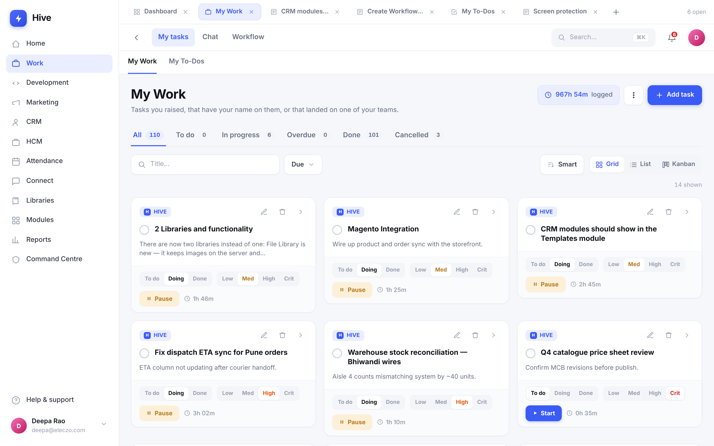
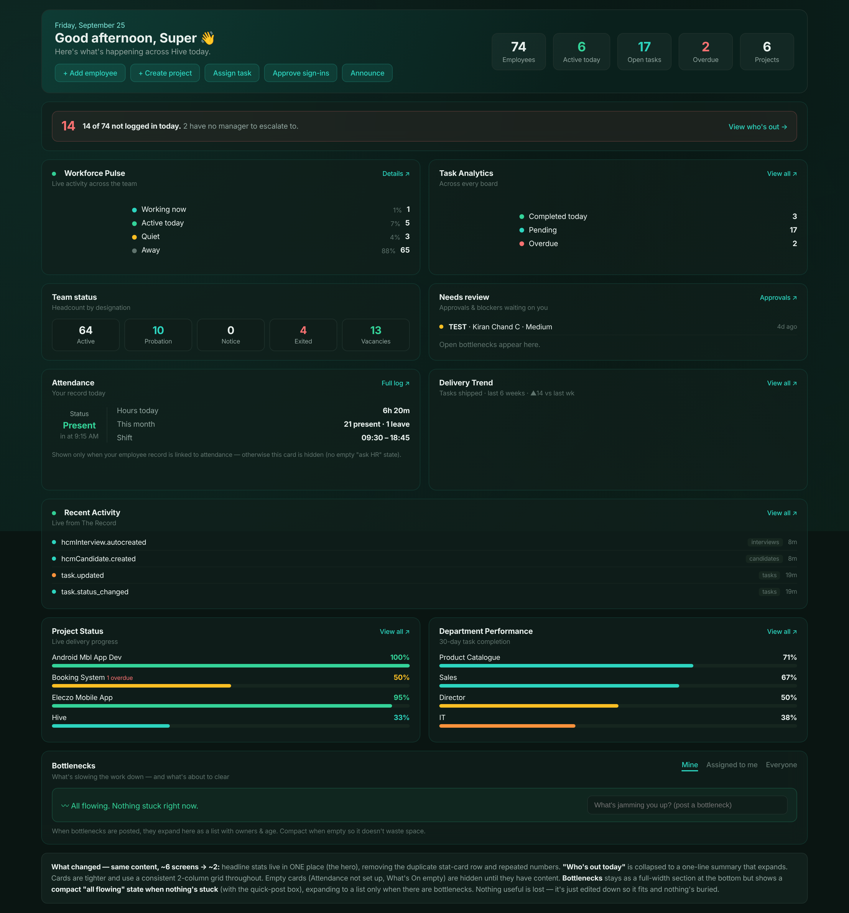
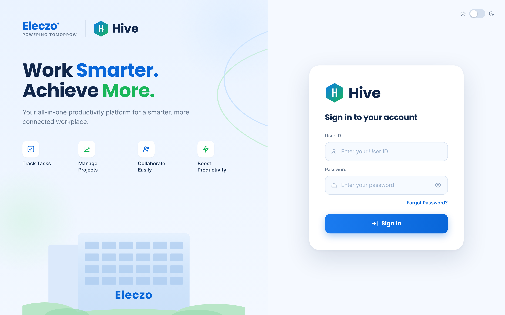
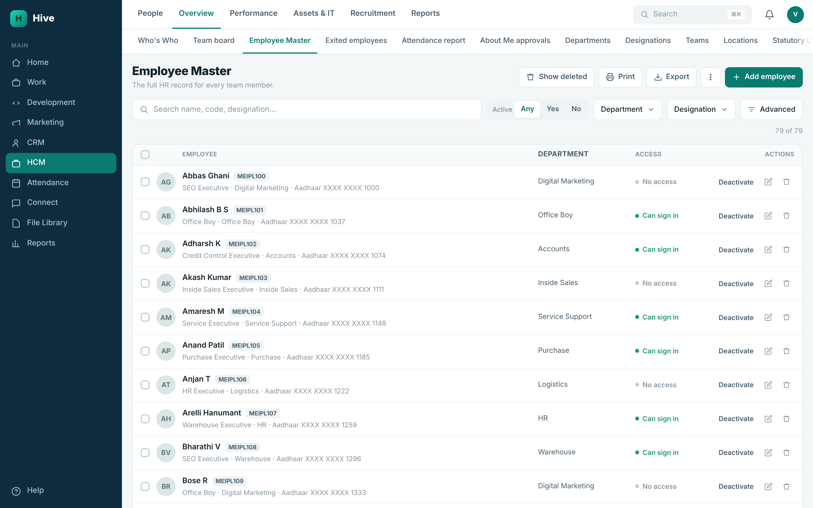
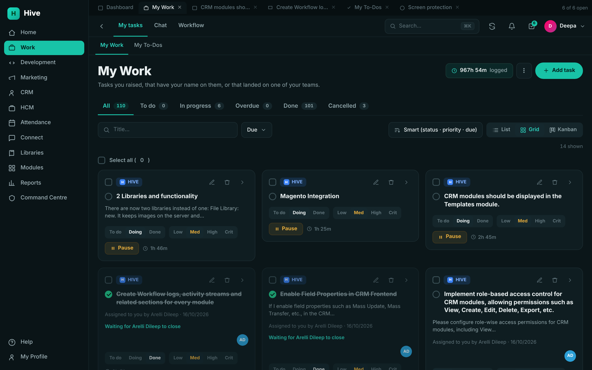

### CRM
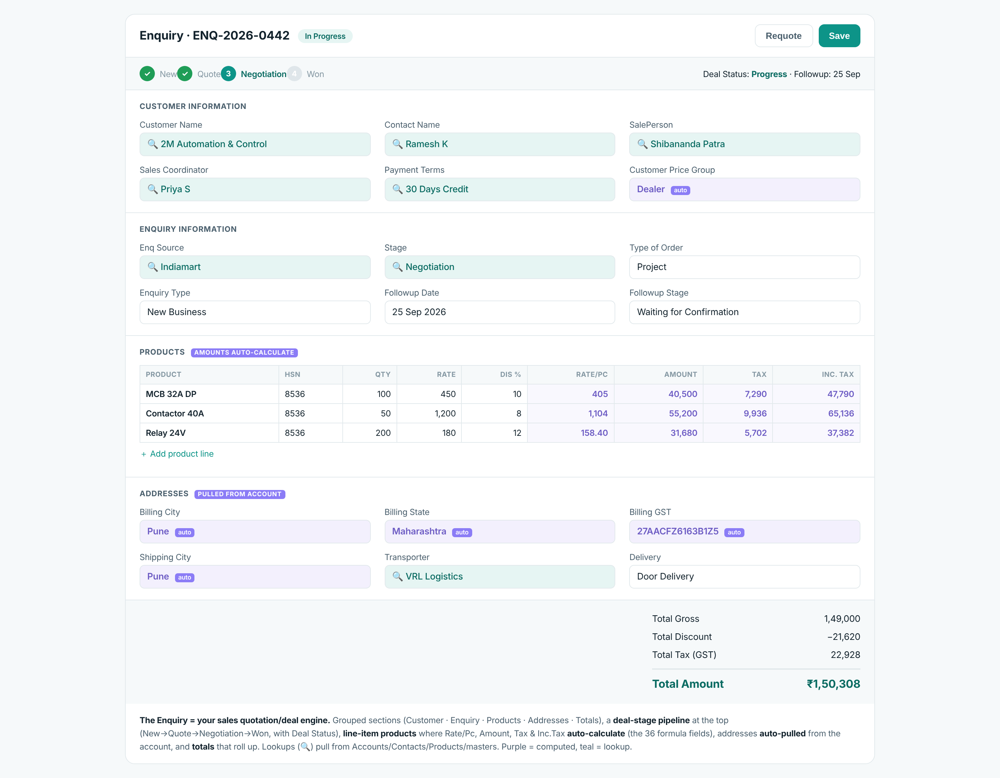
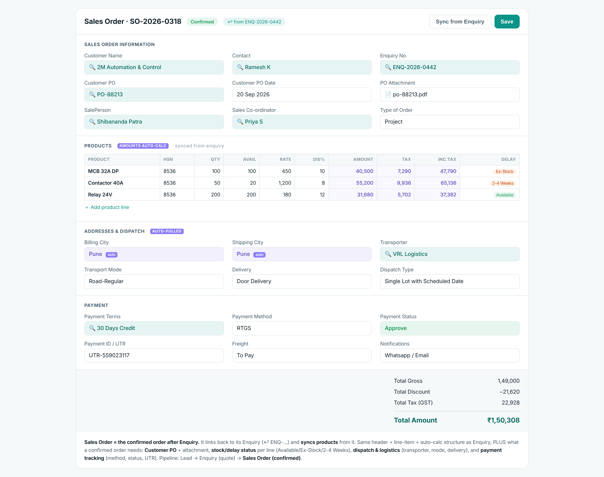
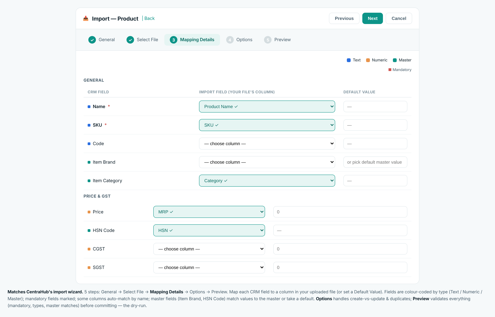
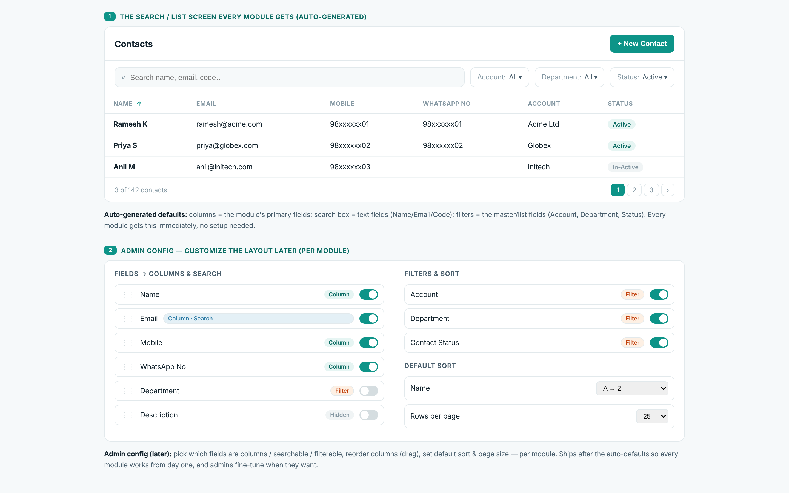

### Responsive (mobile)

  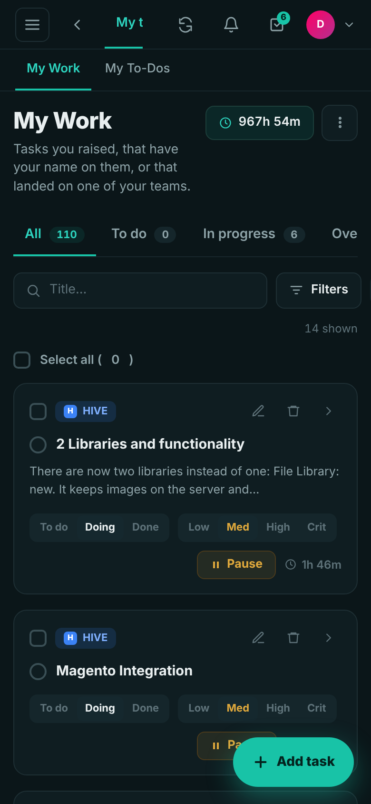
  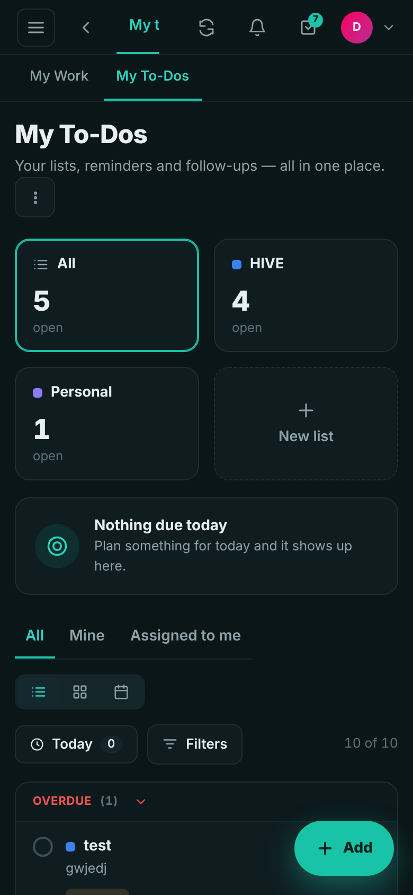

## What I built

### AI email triage and communication agents
- **Email triage engine** that sorts inbound customer mail for the support desk. It uses a durable job queue with idempotent enqueue, an atomic claim so concurrent pollers make exactly one model call, bounded retries, and stale-run reclaim. A failure never breaks the caller; the email simply stays unsorted.
- **Pluggable model providers** (Claude or an on-prem local model) behind one interface, with structured JSON-schema output validated by zod.
- **"Model proposes, code guards" safety model.** The model only chooses from server-supplied lists and drafts text. The code rejects anything off-list. Inbound email is always treated as untrusted data to resist prompt injection.
- **Three Communication AI agents:** reply drafter, thread summarizer, and follow-up/SLA watcher. They run automatically, but anything outbound or record-changing waits in a **human review queue** and leaves only through the existing permission-checked send path once approved.

### Metadata-driven CRM platform
- Modules, fields, options, permissions and cascades are stored as **data**, not hard-coded.
- A **schema generator** creates real database columns on demand, with safe handling of pending, built and failed states.
- A configurable **field-rules engine** (conditional logic and formulas), **field-mapping-driven record conversion**, and **cascading reference fields**.
- A shared **Fields & Schema admin**: one field registry and one create/edit form reused across every CRM module instead of being forked per module.
- Redesigned CRM modules: Enquiry, Product, Sales Order, Ticketing, Receipt, SO Cancellation and Change Request, plus Masters, Import/Export and Search Layouts. Business logic, financial calculations and approval workflows were preserved.

### HR and workforce
- Employee Master and the full authentication flow (login, OTP, forgot password, location confirmation).
- Attendance: My Attendance and Who's Out.
- **Biometric sync** with eSSL / eTimeTrackLite: a strictly read-only SQL sync that matches punches to employees, classifies attendance, and feeds the **KRA/incentive engine**.
- Hiring and recruitment: job-opening approvals, designations and org chart.

### Communication and mailbox
- Microsoft Graph / Outlook sync for personal and shared mailboxes.
- Threaded ticket replies, with the SLA clock stopped on the first response.
- An **unattended-email watchdog**: a business-hours-aware SLA monitor that escalates and sends an automatic acknowledgement.

### Design system and responsive engineering
- A **scoped design-token approach** (CSS custom properties on module wrapper classes) that re-skins one module at a time **without touching the shared app shell**. It is incremental and reversible.
- Responsive layouts from **320px to 1920px** across 10 breakpoints, with 44px touch targets, 16px inputs and zero horizontal overflow, verified by a Playwright test harness.

### Integrations and data
- Microsoft 365 / Outlook, Brevo email, and Interakt WhatsApp broadcast (bulk send, recipient picker, templates).
- SQL Server to PostgreSQL migration analysis and an Oracle vs PostgreSQL evaluation.

## Engineering approach

- **Ground before building.** Every change started from reading the real components, schema and APIs, not from assumptions.
- **Isolate risk.** Changes are additive. Permissions, business rules, audit trails and financial logic stay intact.
- **Safety-first AI.** Structured output, server-side guards, untrusted-input handling, and human approval before anything reaches a customer.
- **No fabricated data.** Counts, statuses and screens come from the real backend.

## Challenges

- Adding useful AI to a live support workflow without any risk of an unapproved message reaching a customer.
- Applying a cohesive design language across a large production codebase without destabilising shared navigation.
- Reconciling redesign mockups with real system constraints, separating true redesigns from net-new features.
- Keeping dense, data-heavy enterprise screens responsive and accessible across a wide range of devices.

## Contact

- Email: deepatil0212@gmail.com
- LinkedIn: [linkedin.com/in/deepa-patil-332925345](https://www.linkedin.com/in/deepa-patil-332925345)
